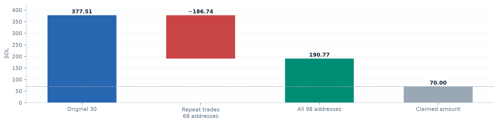

# SHYFT wallet review

Evidence and reports for the Solana token [`CqPsrJcJq9DLefXZyWmj7vmvANYYkCoK94poJcZxpump`](https://solscan.io/token/CqPsrJcJq9DLefXZyWmj7vmvANYYkCoK94poJcZxpump), including common funding, repeat purchases (buybacks), and the claimed 70 SOL result.

Audit date: **23 October 2026**. Displayed times: **UTC+4**. This repository contains a historical snapshot; it does not monitor subsequent activity.

## Start here

| Purpose | File |
|---|---|
| Read the illustrated English report | [English PDF - 14 pages](english/SHYFT-audit-buybacks-EN.pdf) |
| Ask another AI to review the calculation | [Standalone AI review packet](english/AI-REVIEW-SHYFT-EN.md) |
| Process exact amounts programmatically | [Structured JSON](english/audit-data-EN.json) |
| Verify against raw transaction responses | [English evidence archive](english/evidence-EN.zip) |
| Explore buys and sells by wallet | [English interactive chart](english/interactive-trades.html) - download and open in a browser |
| Read the Russian report | [Russian PDF](SHYFT-audit-buybacks.pdf) / [Russian written report](report.md) |
| Access the original Russian evidence package | [Russian evidence archive](evidence.zip) |

The English and Russian reports describe the same investigation. No private keys, API credentials, or signing tools are included.

## Result within the examined scope

| Component | Cash result, SOL |
|---|---:|
| Original 30 addresses | +377.509473693 |
| Additional 68 repeat-purchase addresses | -186.743455421 |
| **Base result for all 98** | **+190.766018272** |
| Conservative scenario after additional deductions | **+190.512257201** |

This is a **cash result with the full purchase outlay deducted**, including the cost of unsold tokens. It is not FIFO realized profit, mark-to-market PnL, or an established amount owed to any person. Some additional deductions are unallocated general expenses or reserves; deducting them in full is a conservative scenario, not an exact expense allocation.

The identified trades and repeat purchases do not explain a 70 SOL result. A broader accounting outcome could depend on unverified external costs, contractual shares, other wallets, or later activity. The remaining **106,843,602.069960 SHYFT** on the examined addresses are unvalued. External recipients are excluded where common control has not been established.



## Evidence coverage

- 30 user-supplied addresses plus 68 additional repeat-purchase addresses.
- 326 SHYFT ledger entries: 101 buys, 215 sells and 10 outgoing token transfers.
- 75 operational funding records covering all original addresses before their first purchase.
- 68 sale -> SOL transfer -> repeat-purchase chains, all within one slot; 63 are consecutive transactions.
- 107 major withdrawal paths through 10,700 intermediate addresses and 10,807 transfers.
- 11,916 raw transaction responses in each evidence archive.

Common operational funding links the original addresses to [`Hg29Zv3GY1Bbp7JQ7Lbawk8e3cLDs67EKGifT1JUUzL3`](https://solscan.io/account/Hg29Zv3GY1Bbp7JQ7Lbawk8e3cLDs67EKGifT1JUUzL3). Common funding supports operational linkage; it does not establish legal ownership or prove a single atomic bundle.

History for the scoped addresses was rechecked through finalized slot **460222992**. Token balances were captured at slots **460217130-460218948**; collector at **460218950**; external recipients at **460231497-460231502**. See the reports for tracing boundaries and incomplete small exits.

## Review with another AI

Upload [AI-REVIEW-SHYFT-EN.md](english/AI-REVIEW-SHYFT-EN.md) first. It includes the methodology, limitations, exact cash ledger, wallet register, funding records and repeat-purchase chains, with a suggested independent-review request. Ask the reviewing AI to recompute the numbers and challenge the assumptions.

For verification against primary data, also supply [evidence-EN.zip](english/evidence-EN.zip) to a system that can extract archives and execute Python. The Markdown packet alone enables a review of the derived tables; it is not independent authentication of blockchain data.

## Reproduce the evidence checks

Download and extract either evidence archive into its own directory. From that extracted directory:

```bash
# macOS
shasum -a 256 -c SHA256SUMS.txt

# Linux alternative
sha256sum -c SHA256SUMS.txt

# Python 3, standard library only
python3 verify_evidence.py
```

The verifier reconciles cash movements and token balances against the archived raw responses, checks the funding and repeat-purchase records, and reconciles the 107 withdrawal routes and their costs. Checksums detect file changes; they do not independently authenticate RPC responses. Important transactions can be re-fetched from Solana mainnet using the supplied signatures.

**Manifest paths refer to the contents of the extracted archive**, not the top-level repository layout. The standalone `SHA256SUMS.txt` files mirror the corresponding archive manifests.

## Main tables

- [98-address data and methodology](english/README-EN.md)
- [Original 30 wallets](english/30-wallets.csv)
- [Additional 68 wallets](english/68-additional-wallets.csv)
- [Full SHYFT cash ledger](english/transaction-ledger.csv)
- [Funding evidence](english/launch-funding-proof.csv)
- [Repeat-purchase evidence](english/buyback-proof.csv)
- [Withdrawal path summaries](english/complete-path-summary.csv)
- [All traced SOL transfers](english/complete-SOL-routes.csv)
- [Route costs](english/route-costs.csv)
- [Other expense adjustments](english/extra-expenses.csv)
- [Collector flows](english/collector-flows.csv)

English deliverables are in [`english/`](english/). The original Russian files and shared evidence tables are retained at the repository root. Interactive HTML files are self-contained and work locally; GitHub's source view does not execute them.
